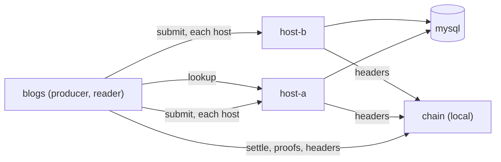

# Quickstart

In about five minutes, on one machine: run two overlay hosts, produce a log
stream to both in unicast mode, read it back, and verify an interval
against block headers. No coin is needed, because a local chain stands in
for the network; the last section says what changes on the real one, and
what costs money there.

You need [Docker](https://docs.docker.com/get-docker/) with Compose, and
this repository (or just its `deploy/quickstart/compose.yaml`).



## 1. Start the local chain

```console
$ cd deploy/quickstart
$ docker compose up -d chain
$ alias blogs='docker compose run --rm -T blogs'
```

`chain` is a stand-in for the network: it serves a node's API, mines every
transaction it is sent at once, and is the header source both the hosts
and `blogs` check proofs against. Nothing it mines is money. The `blogs`
service is already configured for it and for the two hosts, in unicast mode
(the settings are in `compose.yaml`).

The images are `ghcr.io/lightwebinc/blogs`, `blogs-host` and
`blogs-devchain`. To build them from a checkout instead of pulling them:
`make docker-build` and `make docker-build-host` ([docs/self-host.md](docs/self-host.md#5-building-the-image)).

## 2. Create a producer and a stream

```console
$ blogs init
created /home/nonroot/.blogs
identity     03965f…37ee
fund address mu6Fa…xH2 (regtest)
$ blogs fund
pool after:  101 output(s), 505000000000 sat (+101); immature 100; node tip 801
$ blogs stream new app | tee stream.txt
stream   app_yuqhfqxzfo
topic    tm_log_app_yuqhfqxzfo
producer 03965f…37ee
host     BLOGS_STREAMS=app_yuqhfqxzfo=03965f…37ee
$ sed -n 's/^host *//p' stream.txt > .env
$ STREAM=$(sed -n 's/^stream *//p' stream.txt) PRODUCER=$(sed -n 's/^producer *//p' stream.txt)
```

`init` made an identity key, which is the producer, in the `home` volume.
`fund` mined 101 blocks to the fund address, so one block's coin is mature.
The stream's name gets a random suffix, so nobody else's stream shares its
topic, and the `host` line is what a host needs to keep it: `.env` hands it
to both.

## 3. Start two hosts

```console
$ docker compose up -d
$ blogs doctor
...
mode        unicast: every object to each of 2 host(s), published once 2 take it (quorum all)
host        http://host-a:8080 answering
host        http://host-b:8080 answering
```

The first start takes a few seconds while MySQL initialises; run `doctor`
again until both hosts answer.

## 4. Produce, read, verify

```console
$ seq 1 40 | sed 's/^/hello from blogs, line /' | blogs produce $STREAM -max-lines 10
...
stream app_yuqhfqxzfo: published seq 1 to 4
anchored to seq 4: interval 1, token 0cead…52dc, mined at height 804
host http://host-a:8080: took 7 object(s), missed 0
host http://host-b:8080: took 7 object(s), missed 0
$ blogs read $STREAM $PRODUCER | tail -2
hello from blogs, line 39
hello from blogs, line 40
$ blogs verify-interval $STREAM $PRODUCER 1
interval 1  token 0cead…52dc  height 804  seqs 1 to 4
...
VERIFIED interval 1 of app_yuqhfqxzfo by 03965f…37ee: seqs 1 to 4, root 5d7f…3999, committed no later than block 804
```

`produce` cut the 40 lines into four signed batches, sent each (and the
funding trees they spend) to both hosts, then anchored all four in one mined
token. `read` checked every batch it printed: the producer's signature, its
place in the stream, and its funding parent's proof against the headers.
`verify-interval` is the auditor's check: the anchor is mined, and the root
over the four batches is the one the anchor commits. Exit status is `0`
verified, `1` refused, `2` a usage or transport error, `3` incomplete.

## 5. See the unicast tradeoff

With no multicast plane, hosts do not pass objects to each other. Stop one,
and let the producer publish with only one host taking each object:

```console
$ docker compose stop host-b
$ seq 41 50 | sed 's/^/hello from blogs, line /' | blogs -quorum one produce $STREAM
warning: a quorum of 1 of 2 hosts is below a majority: an object counts as published while most hosts lack it, until a backfill (docs/limits.md)
seq 5: host http://host-b:8080 MISSED it after 4 tries: ...
...
host http://host-a:8080: took 2 object(s), missed 0
host http://host-b:8080: took 0 object(s), missed 2: seq 5, anchor interval 2
a host missed objects; once it is back, copy them from the others: blogs backfill app_yuqhfqxzfo 03965f…37ee -seqs 5-5 -anchors 2
$ docker compose start host-b
$ blogs -hosts http://host-b:8080 verify-interval $STREAM $PRODUCER 2
interval 1  token 0cead…52dc  height 804  seqs 1 to 4
INCOMPLETE interval 2: no host answered; an empty answer proves nothing
$ blogs backfill $STREAM $PRODUCER -seqs 5-5 -anchors 2
...
backfill app_yuqhfqxzfo to http://host-b:8080: 1 held, 2 filled, 0 missing, 0 refused, 0 unserved, 0 sweep(s) carried
note: backfill carried batches and anchors, not sweeps: ...
$ blogs -hosts http://host-b:8080 verify-interval $STREAM $PRODUCER 2
VERIFIED interval 2 of app_yuqhfqxzfo ...
```

With the default quorum, `all`, that `produce` would have stopped at seq 5
with the batch saved, and the next run would publish it. The cost of no
plane is that the producer sends everything to every host itself, and a
host that missed something needs a backfill. [docs/unicast.md](docs/unicast.md)
has the whole design.

## 6. Clean up

```console
$ docker compose down        # stop; the volumes keep the chain, the hosts and the home
$ docker compose down -v     # and forget everything
```

## On the real network

The same commands, with the local stand-ins replaced:

| | Here | On the real network |
| --- | --- | --- |
| Header source (`header_url`) | the local chain | `woc:main`: the public WhatsOnChain API. Every header is checked for proof of work, so the source cannot lie without mining a block. Or `chaintracks:URL` for a header service you run |
| Hosts (`hosts`) | `host-a`, `host-b` | your own ([docs/self-host.md](docs/self-host.md)), or anyone's that keeps your stream |
| Settlement (`settle`) | the local chain's RPC | an ARC service, for example `arcade:https://arc.gorillapool.io/v1` |
| Node (`asset`) | the local chain | a node's asset API. The producer asks it whether its funding trees and anchors have mined, and no public service offers it, so **a producer on the real network needs access to a node** |
| Coin | mined locally | real BSV: pay the fund address `init` printed from any wallet, then `blogs fund -txid <txid>` once it has one confirmation |

Readers and auditors need no node and no coin: a header source, the hosts,
and `tx_source = woc:main` so an auditor can read the fee trees anchors
spend.

```console
$ blogs -header-url woc:main -tx-source woc:main -hosts https://logs.example.com \
    verify-interval app_qzxkvbmwtr 02c0ffee… 1
```

**What costs money.** At the default fee of 1 satoshi per byte, each batch
costs about 50 satoshis (its share of the funding tree it spends, and the 1
satoshi it carries) and each anchor about 600. A stream anchored every ten
minutes around the clock spends under 100,000 satoshis (0.001 BSV) a day on
anchors; the batch cost follows how much you log. About 50,000 satoshis
starts a stream: the first funding trees, and a reserve so the next tree is
minted before the current one runs out. `blogs doctor` shows the pool, and
`blogs sweep -retire` returns unused funding outputs to it.

## Next

- [docs/usage.md](docs/usage.md): every command, flag, setting, exit code and message
- [docs/user-guide.md](docs/user-guide.md): the guide: concepts, producing, reading, auditing, archiving, sweeping, troubleshooting
- [docs/unicast.md](docs/unicast.md): unicast mode, quorums, retries and repair
- [docs/limits.md](docs/limits.md): every default and cap, and why
- [docs/self-host.md](docs/self-host.md): a host other people reach
- [docs/spec.md](docs/spec.md): the record formats and the rules every host and reader applies
- Stuck? `blogs doctor` reports the home, the pool, the streams, and whether every configured endpoint answers.
