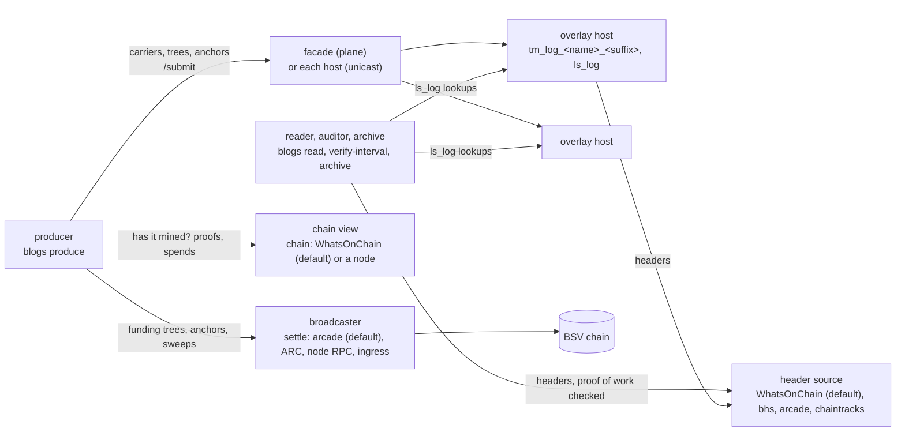

# Architecture

How blogs is put together: the parties, the objects they exchange, the
trust each places in the others, and where each piece lives in this
repository. The normative rules are in [spec.md](spec.md); this page is the
map.

## The parties

| Party | Holds | Trusted for |
| --- | --- | --- |
| **Producer** | the identity key (the producer *is* this key), a coin pool, and each stream's state in a producer home | nothing a reader cannot check: every batch is signed and every interval is anchored on chain |
| **Overlay host** | the stream's batches, anchors and funding trees, admitted by the blogs module's topic manager | availability only. A host can withhold; it cannot forge, because every answer is verified by whoever asked |
| **Broadcaster** (`settle`; GorillaPool's public arcade by default) | nothing | getting funding trees, anchors and sweeps to miners. Its verdict is held to the chain view's spends |
| **Chain view** (`chain`; WhatsOnChain by default, or a node's asset API) | the chain | transactions and proofs, which are checked (a transaction against its txid, a proof against the header source), and "unspent" and "not mined", which are its word alone. No node is needed; a node of your own removes that last trust |
| **Header source** (`header_url`; WhatsOnChain by default) | block headers | nothing: every header is checked for proof of work, so it cannot lie without mining a block |
| **Reader, auditor, archive** | optionally, an archive directory | nothing; it is the party that checks |

## The objects

| Object | Mined? | What it is |
| --- | --- | --- |
| **Funding tree** | yes | one transaction with many small outputs on the stream's topic, paid from the coin pool. Batch trees fund carriers; anchor fee trees pay anchors' fees |
| **Carrier** | never | the transaction a batch rides in. It spends one funding tree output, so it verifies by SPV against the tree's proof without paying for block space. Its txid is the batch's **commitment** |
| **Batch** | (in a carrier) | up to thousands of log lines, signed by the producer, with a `seq` and `prev` (the previous batch's commitment). Lines ride in the record (`full`) or live elsewhere under their SHA-256 (`digest`) |
| **Anchor** | yes, one per interval | commits the RFC 6962 Merkle root over the interval's commitments and spends the previous interval's anchor, so the anchors form one chain covering every batch once |
| **Sweep** | yes | spends funding outputs: a retraction (the carriers that spent them become double spends, and hosts drop their bytes) or a retirement (unused outputs back to the pool) |

So a stream costs one mined anchor per interval plus its share of funding
trees, however many batches it publishes. A batch is final for a reader
when its funding tree is mined and its carrier is signed; it is proven in
order and in time once its interval's anchor is mined.

## Flow

1. **Fund.** `init` creates the home and prints a fund address. On mainnet
   or testnet the producer pays it from its own wallet and imports the
   payment: `fund -beef` takes the payment as BEEF and checks it against the
   header source with no lookup, and `fund -txid` reads a mined payment from
   the chain view and checks its proof. (`fund` without either mines
   coinbase: only on a regtest chain you run, for development and tests.)
2. **Stream.** `stream new` draws a random suffix so nobody else's stream
   shares its topic `tm_log_<name>_<suffix>`, and prints the
   `BLOGS_STREAMS` line a host needs to admit only this producer.
3. **Produce.** `produce` mints funding trees, waits for them to mine,
   cuts lines into batches, signs each into a carrier, persists it, and
   publishes it: once to the facade on the multicast plane, or to every
   host in unicast mode. Every interval it builds an anchor over the
   unanchored commitments, settles it through the broadcaster, waits for it
   to mine, and publishes it with its proof.
4. **Read and audit.** A reader asks the hosts' `ls_log` lookup service for
   a stream's batches, anchors and funding trees, and checks every answer
   against its own header source: signature, `seq`, `prev` link, the
   funding parent's proof, the anchor chain, and the interval's root.
5. **Repair and keep.** `backfill` copies what one host lacks from its
   siblings, verified. `archive` keeps one host's copy, with every
   interval's proof and every anchor's fee tree, in local files that can be
   audited with no host at all.

Every step a producer takes is written to the stream's state before it is
sent, so a crash, a kill or an unreachable endpoint resumes with the same
bytes and never forks the stream ([usage.md](usage.md#restart-and-crash)).

## Plane and unicast

| | `mode = plane` | `mode = unicast` |
| --- | --- | --- |
| The producer submits | once, to `facade` | to every host in `hosts` |
| Hosts receive from | [BSV Layered Multicast](https://github.com/lightwebinc/bsv-multicast), which repairs loss | the producer only |
| A host that missed something | repaired by the plane | `blogs backfill` |
| Needs | a plane carrying the topic | only the hosts |

Readers are the same in both. [unicast.md](unicast.md) has the tradeoff.

## Code layout

| Path | What |
| --- | --- |
| `cmd/blogs` | the command: argument parsing, the producer home, and each command |
| `cmd/devchain` | the local development chain: a private regtest stand-in for a node and header source, for the sandbox and tests |
| `cmd/vectors` | writes and checks the golden vectors under `testdata/vectors` |
| `internal/config` | settings: flags, `BLOGS_*`, the config file, defaults |
| `internal/limits` | the defaults and caps of [limits.md](limits.md) |
| `internal/logrec` | the byte-level contract: the batch record, the locator, the anchor record, the RFC 6962 leaf rule, and the topic manager's admission rules |
| `internal/produce` | the producer engine: batches, carriers, funding trees, anchors, sweeps, crash recovery, built on bcommon's producer package |
| `internal/state` | a stream's durable state in the producer home |
| `internal/reader` | the `ls_log` client that verifies every answer |
| `internal/archive` | the archive's files and interval proofs |
| `internal/ingest` | the logging sidecar: the doors (syslog, OTLP logs, Loki push), the line form, batching onto the producer engine, forwarding to Loki ([backend.md](backend.md)) |
| `internal/gateway` | the read gateway: the Loki API proxy that marks lines against an archive, coverage, retention metering |
| `internal/metrics` | counters and gauges in the Prometheus text format |
| `internal/testchain` | in-process stand-ins for the chain and a host, for tests |
| `internal/vectors` | the generator behind `cmd/vectors`: transaction, refusal and query vectors from the Go codec |
| `host/` | the host module in TypeScript: `tm_log_<stream>` topic managers and the `ls_log` lookup service, bundled into one file for a reference overlay host ([host.md](host.md)). Frozen: bug fixes only |
| `module/` | the same module in Go, for a Go overlay host built on bcommon's engine-neutral module contract ([host.md](host.md#the-go-module)) |
| `deploy/` | `compose.yaml` for a public host, `quickstart/compose.yaml` for the sandbox |

The Go codec (`internal/logrec`) and the TypeScript codec (`host/src`) each
decode the other's golden vectors, so the producer and the hosts cannot
drift apart unnoticed. The shared building blocks (wallet, funding trees,
carriers, header client, publishing, unicast submission with retries and a
quorum) come from
[bcommon](https://github.com/lightwebinc/bcommon); the only other direct Go
dependency is [go-sdk](https://github.com/bsv-blockchain/go-sdk).

## What is frozen

The record formats, topic and lookup names, and signing key derivations a
reader depends on are listed in [frozen.md](frozen.md). Everything else,
including flags and defaults, may change between releases.
