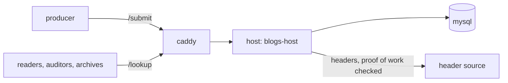

# Running a host

A blogs host is a reference overlay host with the blogs module loaded: it
admits a stream's carriers, funding trees and anchors, and answers the
lookup classes readers, auditors and archives ask. One host is a complete
deployment; several are replicas of each other. Names here are
illustrative: the host is `logs.example.com`, the stream `app_qzxkvbmwtr`.



To try everything on one machine first, with no coin and no domain, use
[QUICKSTART.md](../QUICKSTART.md). This page is for a host other people
reach.

## 1. The stream

A host keeps the streams it is told to. The producer creates a stream and
prints the line a host needs:

```console
$ blogs stream new app
stream   app_qzxkvbmwtr
topic    tm_log_app_qzxkvbmwtr
producer 02c0ffee...
host     BLOGS_STREAMS=app_qzxkvbmwtr=02c0ffee...
```

`BLOGS_STREAMS` is a comma list, one entry per stream: `<stream>=<key>` (or
several keys joined by `+`) admits only those producers; `<stream>=open`
admits anyone's batches on the stream. Openness is stated, never inferred
([host.md](host.md)).

## 2. Start it

On a server with Docker, ports 80 and 443 free, and a DNS name pointing at
it, from a copy of [deploy/compose.yaml](../deploy/compose.yaml):

```console
$ export HOST=logs.example.com BLOGS_STREAMS=app_qzxkvbmwtr=02c0ffee...
$ docker compose up -d
```

Every later `docker compose` command (`logs`, `exec`, `down`) needs both
variables too: `export` them, or put them in a `.env` file beside
`compose.yaml`.

| Service | What it is |
| --- | --- |
| `host` | `ghcr.io/lightwebinc/blogs-host`: the reference overlay host with `tm_log_<stream>` and `ls_log` built in. It admits objects, answers lookups, and checks every proof against its header source |
| `db` | MySQL on the named volume `db`, reachable only inside the project's network |
| `caddy` | TLS for `HOST` (the certificate is fetched on first start), proxying `/submit` and `/lookup`; `/admin/*` and `/metrics` answer 404 from outside |

| Variable | Default | |
| --- | --- | --- |
| `BLOGS_STREAMS` | none | the streams this host keeps (step 1) |
| `HOST` | none | this server's DNS name; several, comma separated, are allowed |
| `HEADERS` | `woc:main` | the host's header source; `woc:test`, or `chaintracks:https://headers.example.com/v2` for one you run |
| `NETWORK` | the source's own | `main`, `test` or `regtest` |
| `ADMIN_TOKEN` | random per start | bearer token for `/admin` |
| `SYNC_PEERS` | none | hosts to catch up from with GASP, `tm_log_app_qzxkvbmwtr=https://other-host.example.net` |
| `DB_PASSWORD` | a fixed internal value | the database is reachable only from the host container |
| `DB_BUFFER_POOL` | `128M` | MySQL's buffer pool; raise it on a bigger server |
| `BLOGS_HOST_IMAGE` | `ghcr.io/lightwebinc/blogs-host:latest` | the image to run |

To add a stream later, append its entry to `BLOGS_STREAMS` and run `docker
compose up -d` again. The image derives `OVERLAY_TOPICS` from
`BLOGS_STREAMS`, so the two cannot disagree; set `OVERLAY_TOPICS` yourself
only to carry other topics beside them, and then list every blogs topic in
it as well.

## 3. Check it

From anywhere with the `blogs` command and a header source:

```console
$ blogs -hosts https://logs.example.com -header-url woc:main doctor
...
host        https://logs.example.com answering
```

Once the producer has published, any reader verifies what the host serves:

```console
$ blogs -hosts https://logs.example.com -header-url woc:main -tx-source woc:main \
    verify-interval app_qzxkvbmwtr 02c0ffee... 1
```

## 4. Getting the stream's objects

How objects reach the host depends on the producer's mode
([unicast.md](unicast.md)):

- **Unicast.** The producer lists this host in its `hosts` and submits
  every object to it directly. Nothing else is needed.
- **Plane.** The host receives the stream's topic from the multicast plane,
  which needs the topic in the plane subscription that feeds the host. The
  module decides admission, not delivery.

Either way, a host that joins late, or was down, is filled from a sibling
that holds the stream:

```console
$ blogs -hosts https://logs.example.com,https://other-host.example.net \
    backfill app_qzxkvbmwtr 02c0ffee... -seqs 1-500 -anchors 12
```

GASP (`SYNC_PEERS`, then `POST /admin/startGASPSync` from inside the
project) also catches a host up, but it carries unspent outputs only, so an
anchor reaches a host that way only once the host holds what the anchor
spends; `backfill` is the complete path ([host.md](host.md#limits)). A
host that was down when the producer swept batches still serves them: add
`-sweeps` (with `asset` or `tx_source`), which finds each held batch's
sweep on chain and submits it. A producer on the plane that lists your
host in its `hosts` also sends you every sweep directly.

## 5. Building the image

The published image is `ghcr.io/lightwebinc/blogs-host`. To build it from
this repository, name the reference overlay host image it is added to:

```console
$ make docker-build-host REFERENCE_HOST_IMAGE=<reference overlay host image>
$ make docker-smoke-host
```

That image must run its application as `/app/dist/index.js` with its
`node_modules` beside it and load the module files named in
`OVERLAY_MODULES`, which the image sets. The module itself is
`host/bundle/blogs-module.js`, and [host.md](host.md) covers loading it
into a host you already run.
